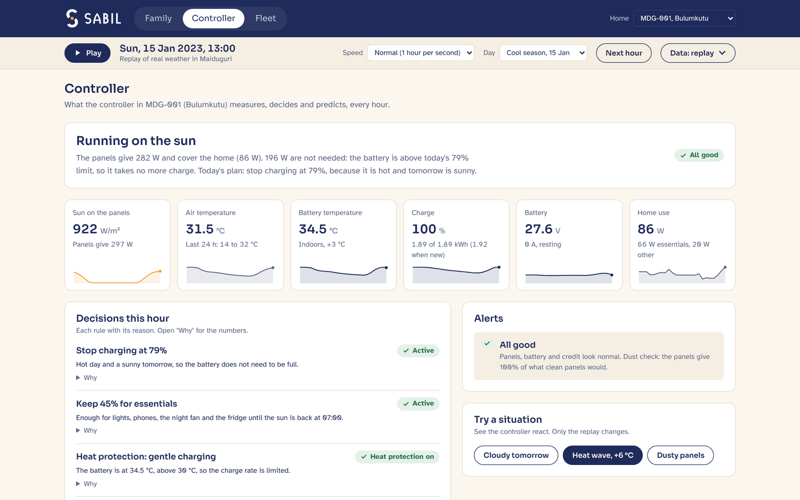

<p align="center">
  <picture>
    <source media="(prefers-color-scheme: dark)" srcset="assets/brand/sabil-horizontal-reversed.svg">
    
  </picture>
</p>

# SABIL

**SABIL is a home solar kit whose controller makes the battery last, sold per kWh to Maiduguri
families who lose the grid for months.**

Global Energy Hackathon 2026 · Brief 13 "Power for a city the grid can't protect"
(Maiduguri, Nigeria) · Clean Energy Solutions · Residential. Built during the sprint,
30 October to 1 November 2026, by Youcef Toukal and Younes Toukal.

## Results at a glance

Ten years of hourly NASA POWER weather for Maiduguri (2014-2023), the grid down the whole time,
a five-person home and the same kit. Only the controller changes.

| | Standard kit | SABIL | Source |
|---|---|---|---|
| Essential hours lost in 10 years (lights, phones, night fan, fridge) | 110 | 13 | `results/summary_baseline.json`, `summary_smart.json` |
| Battery life to 80% capacity | 6.2 years | 7.5 years | same |
| Stress tests SABIL wins (96 Monte Carlo + 24 random demand) | | 120 of 120 | `results/experiments/` |
| Generator fuel avoided per home per year | | 212 to 849 L | `results/costs_summary.json` |
| Price per kWh, no ongoing subsidy | | ₦505 | `results/costs_summary.json` |
| Petrol for a generator, same kWh | | ₦715 to ₦2,860 | `results/costs_summary.json` |
| Monthly bill: lights, phones and fans / with a fridge | | ₦5,404 / ₦17,853 | `results/costs_summary.json` |

The kit: 24 V DC, no inverter, 400 W of panels and an LFP battery of 25.6 V 75 Ah (1.92 kWh).
The home: five people, 1.16 kWh a day, 952 Wh of it essentials (`params/`, `src/sizing.py`).

## Why it works

Lithium batteries wear fastest when they sit hot and full. In Maiduguri's heat a standard kit
charges to 100% every sunny day and stays there all afternoon. Every hour, the SABIL controller:

- **Charges for tonight, not to 100%.** On a hot day with a sunny tomorrow it stops at the charge
  tonight needs, plus half of tomorrow's essentials in case the forecast is wrong (never below 70%).
  Before a cloudy day it fills up.
- **Keeps a reserve for essentials** until the sun is back, and serves them first.
- **Moves flexible loads to sunny hours**: phone charging and the fridge's pre-cooling.
- **Charges gently when the battery is hot.**

It plans with a next-day sun forecast. The operator owns the kit and guarantees the battery, so
making it last is how the business earns. The controller is firmware plus about $12 of sensors.

## Try it

**The interface**: open [`app/index.html`](app/index.html) in a browser. It works offline. It
replays real Maiduguri weather hour by hour and shows what the family sees, every decision of the
controller with its reason, and a fleet of example homes. Details in [`app/README.md`](app/README.md).



**The simulation**, about 20 seconds (the weather is already in `data/`):

```bash
pip install numpy pandas matplotlib requests
python src/simulate.py          # 10-year run, standard vs SABIL, prints the comparison table
python src/check_results.py     # energy balance, charge limits, battery energy conservation
python src/cost_model.py        # price per kWh, family bill, generator comparison
```

**Key figures**: `results/figures/fig18_essentials_vs_fade.png` (essential hours as the battery
fades), `fig19_hot_days.png` (two hot April days), `fig20_robustness.png` (120 stress tests),
`fig17_tuning.png` (Bayesian optimisation of the rules), `fig15_cost_per_kwh.png` (cost per kWh).
Full write-up: [`results/RESEARCH_REPORT.md`](results/RESEARCH_REPORT.md). Pitch deck and one-page
summary: [`deliverables/`](deliverables/).

## How we checked it

- **Battery ageing**: the TU Munich LFP model (Naumann et al.) matches the authors' own code
  (SimSES) to a relative difference of 5 × 10⁻¹⁴ (`results/aging_validation.json`). A second model,
  NREL's BLAST-Lite for large prismatic cells, gives the same conclusions
  (`results/aging_robustness.json`). The default is the one that fades faster.
- **Kit size**: chosen from the reliability of the aged system over all ten weather years:
  4 panel sizes × 4 battery sizes × 2 controllers × 2 ageing models (`results/sizing_map.csv`).
- **Robustness**: SABIL lengthens battery life in all 96 Monte Carlo samples (ageing, temperature,
  load, panels) and all 24 random-demand runs (`results/experiments/`).
- **Sun forecast**: twelve models, each tested on years it never saw. The chosen ensemble's
  next-day error is 0.61 kWh/m² a day, against 0.80 for "same as yesterday" and 0.64 for the
  seasonal average (`results/forecast_lab/`). For battery life the forecast matters little:
  7.59 years with it, 7.51 with "same as yesterday". The rules do most of the work.
- **Tuning**: Bayesian optimisation of the six controller settings (Optuna, tuned on 2014-2018,
  tested on 2019-2023) found more battery life only by losing essential hours, so the hand-set
  rules were kept (`results/controller_tuning.json`).
- **The interface runs the same engine**: `python app/build/check_engine.py` runs the simulation
  and the page's engine on 2023 side by side, with the same results.

## Where we are

A simulation on real weather data and working software. No lab test, no field data and no
customer yet. Some inputs are still assumed and marked `TO CONFIRM` in `params/`: the family's
daily routine, a few datasheet values, and ageing models fitted on lab cells rather than this
module.

Next: a 50-home pilot in Borno with a pay-per-use partner, every battery logged hourly, to measure
battery wear in Maiduguri's heat and check those assumptions. The first two weeks are interviews
with the 50 families. The ask is about $40,000 for 50 kits with data logging
(`deliverables/SABIL_pitch_deck.pdf`, slide 5).

## Run everything

```bash
pip install numpy pandas matplotlib requests
python src/weather.py            # downloads NASA POWER 2014-2023 into data/ (already included)
python src/sizing.py             # household load and PV/battery sizing from the NASA years
python src/validate_aging.py     # TU Munich ageing model vs closed form and the authors' SimSES code
python src/validate_aging_nrel.py  # NREL prismatic ageing model vs closed form (and NREL's code, optional)
python src/load_profile.py       # hourly household load from params/household.json
python src/forecast_lab.py       # forecasting lab: ERA5 + NOAA indices, 12 models (GRU and Chronos need torch), learned forecast for the simulation
python src/simulate.py           # baseline + smart (perfect, persistence, learned forecasts) + charts
python src/check_results.py      # contract keys, energy balance, SoC limits
python src/sizing_map.py         # reliability of the aged system: 4 PV x 4 battery sizes x 2 controllers x 2 ageing models
python src/robustness_aging.py   # controller results under both ageing models
python src/experiments.py        # ablation, charge-cap sweep, Monte Carlo, battery placement, random demand, optimal benchmark
python src/plots.py              # all figures
python src/cost_model.py         # cost per kWh, family bill, generator comparison, value of the controller
python src/tune_controller.py    # Bayesian optimization of the controller rules, tested on unseen weather (needs optuna)
python src/exhibits.py           # report and slide exhibits (fig15-fig20, results/figures/deck/)
python src/report.py             # results/RESEARCH_REPORT.md
python app/build/build.py        # rebuilds the interface, app/index.html
python app/build/check_engine.py # interface engine vs the simulation on 2023 (needs Node.js)
```

## Layout (integration contract)

| Path | Owner | What |
|---|---|---|
| `params/household.json`, `system.json`, `battery.json`, `costs.json` | Youcef | inputs with sources |
| `params/sim.json` | Younes | site, years, forecast choice, smart-controller settings |
| `dev_params/` | Younes | first placeholder kit, used only while a `params/` file is missing (no result uses it) |
| `src/sizing.py`, `src/sizing_map.py` | Youcef | household load, kit sizing from NASA POWER, reliability map of the aged system |
| `src/aging_model.py`, `src/aging_nrel.py`, `src/validate_aging_nrel.py`, `src/robustness_aging.py`, `src/cost_model.py`, `src/tune_controller.py`, `src/exhibits.py` | Youcef | ageing entry point (picks the model in `battery.json`), NREL prismatic LFP model and its checks, robustness across ageing datasets, cost model, controller tuning, exhibits |
| `src/aging_naumann.py`, `src/validate_aging.py` | Younes | TU Munich LFP ageing model (default) and its check against SimSES |
| `src/weather.py`, `load_profile.py`, `controllers.py`, `simulate.py`, `plots.py`, `check_results.py`, `params_io.py`, `forecast_ml.py`, `forecast_lab.py`, `datasets.py`, `experiments.py`, `report.py` | Younes | data, simulation, controllers, forecasts and forecasting lab, experiments, charts, report |
| `app/` | Younes | interface: one offline page running the simulation engine, its source and checks |
| `assets/brand/` | Youcef | logo (Solar Access Builds Independent Lives) |
| `deliverables/` | Youcef | pitch deck and one-page summary |
| `results/` | Younes (summaries, hourly CSVs, experiments, forecasting lab, figures, report), Youcef (`sizing_map.csv`, `aging_robustness.json`, `aging_validation_nrel.json`, `load_profile_24h.csv`, `costs_summary.json`, `controller_tuning.json`) | outputs |

No number is typed into the code: every value lives in `params/`.

## Forecasts

The SABIL controller plans with a next-day sun and load forecast:

- `perfect`: tomorrow's real data (upper bound)
- `persistence`: same hour on the most recent past day (realistic, no look-ahead)
- `learned`: the forecasting lab's ensemble, trained on NASA POWER, ERA5 and NOAA climate indices
  and tested on years it never saw; `learned_risk` uses its lower estimate (P10)

All run every time. `params/sim.json → headline_forecast` (persistence) picks which one becomes
`summary_smart.json`.

## Key results (400 Wp, 1.92 kWh, NASA POWER 2014-2023, realistic forecast)

| | Standard | SABIL |
|---|---|---|
| Essential hours lost in 10 years, TU Munich ageing | 110 | 13 |
| Critical hours lost, worst year (TU Munich / NREL ageing) | 32 / 13 | 9 / 9 |
| Battery life to 80% capacity, TU Munich ageing (years) | 6.24 | 7.51 |
| Capacity after 10 years, TU Munich / NREL ageing | 74.6% / 87.4% | 76.6% / 88.7% |

Monte Carlo over ageing, temperature, load and PV uncertainty (96 paired samples): SABIL lengthens
battery life in every sample (`results/experiments/montecarlo_summary.json`).

## Data and tools

NASA POWER hourly weather; ERA5 reanalysis (ECMWF / Copernicus, through the Open-Meteo archive);
NOAA climate indices (ONI, NAO, TNA); Chronos-Bolt (Amazon, pretrained forecasting model, used as a
baseline); SimSES (TU Munich) and BLAST-Lite (NREL) for the ageing checks; Optuna; scikit-learn,
LightGBM, XGBoost, PyTorch, NumPy, pandas, Matplotlib. Interface fonts: Sora and Atkinson
Hyperlegible (SIL Open Font License).

## Main references

- NASA POWER hourly data, Maiduguri 2014-2023
- Naumann et al., J. Energy Storage 17 (2018) 153-169; J. Power Sources 451 (2020) 227666 (TU Munich LFP ageing; SimSES)
- NREL BLAST-Lite, large-format prismatic LFP model (data in J. Energy Storage, doi:10.1016/j.est.2023.109042)
- Narayan et al., Applied Energy 240 (2019) 907-917 (solar home system sizing for the Multi-Tier Framework)
- CLASP / Efficiency for Access appliance technology briefs (2021)
