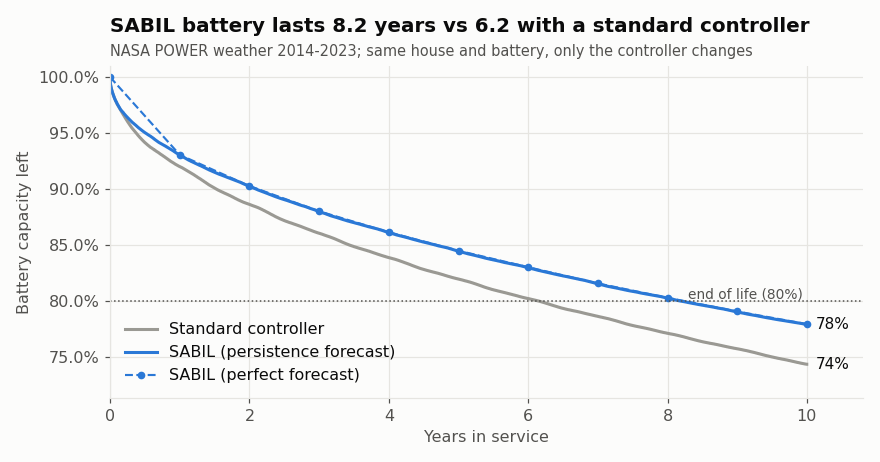
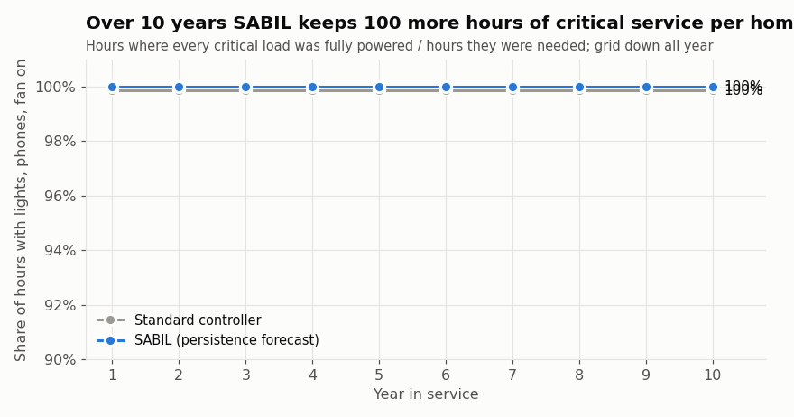
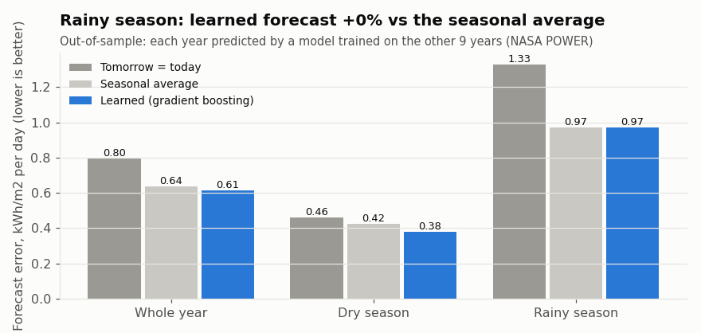
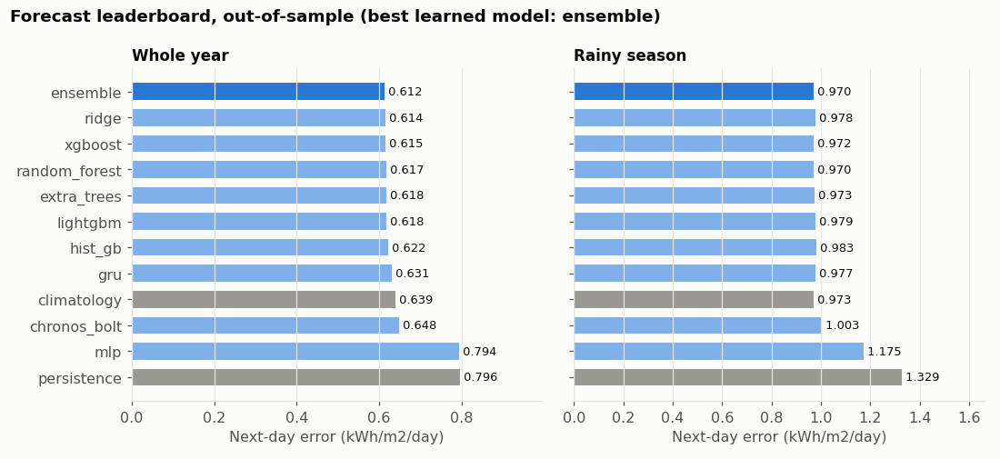
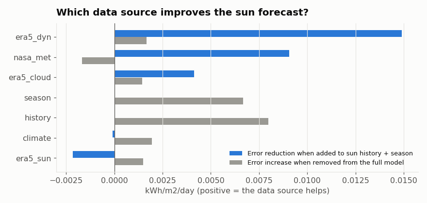
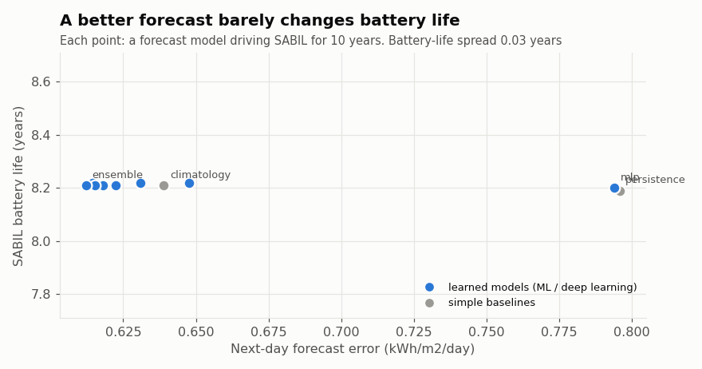
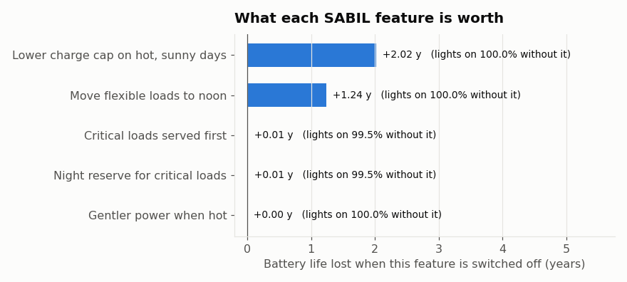
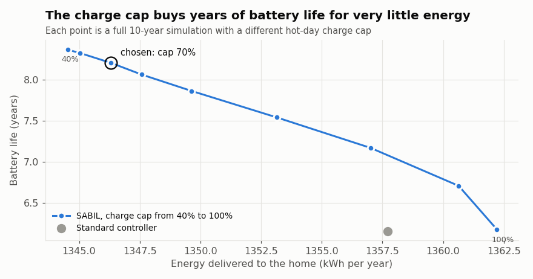
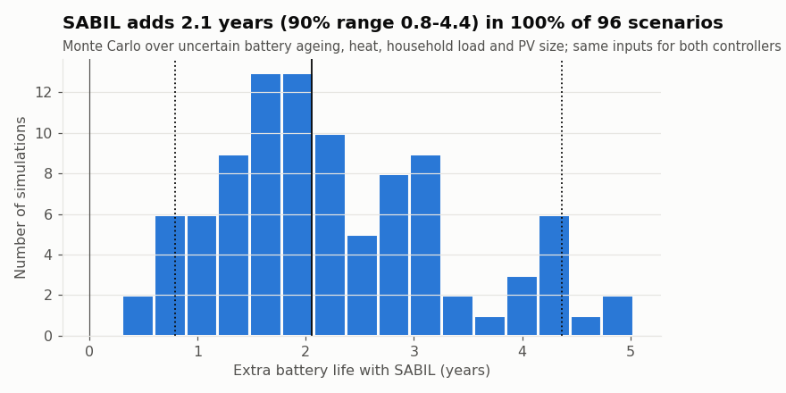
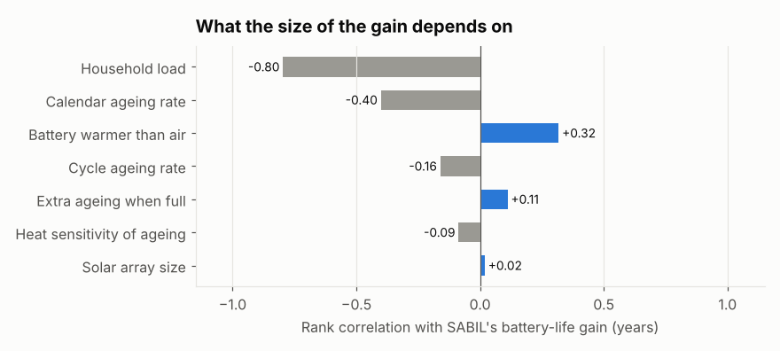

# SABIL: battery-aware control for solar home systems in Maiduguri

*Generated 2026-10-31 22:07 UTC from the result files at commit 77664b5. Every number below is read from `results/`, not typed.*

> **Provisional:** these inputs still use placeholders (`dev_params/`): household, system, battery, costs.

## 1. Question
When the transmission line to Maiduguri is cut (Brief 13), a household solar-plus-battery kit replaces diesel only as long as its battery lasts. Can a controller that knows how batteries age extend battery life in Maiduguri's heat without reducing the hours that lights, phones and fans stay on?

## 2. Method
- **Site and weather:** Maiduguri, Borno State, Nigeria (11.85 N, 13.16 E). NASA POWER hourly irradiance, air temperature and humidity, multi_year: 2014-2023, local time (UTC+1).
- **Household:** 5 people; hourly appliance schedule from `params/household.json`; lights, phone charging and fans are critical loads. Grid assumed down for the whole horizon (worst case of Brief 13).
- **Paired design:** the same house, weather, PV array and battery are simulated twice; only the controller differs. Any difference is caused by the controller.
- **Standard controller:** charges to 100% whenever there is sun, discharges to the low-voltage cut-off, serves all loads equally, runs appliances at their usual hour.
- **SABIL controller:** (1) caps the charge level on hot days when tomorrow is sunny; (2) keeps a night reserve for critical loads; (3) moves flexible loads (iron) to sunny hours; (4) serves critical loads first; (5) limits power when the battery is hot. Plans with a next-day sun forecast.
- **Battery ageing:** semi-empirical LFP/graphite model (Naumann et al. 2018 calendar, 2020 cycle): calendar loss ~ sqrt(time), accelerated by temperature (Arrhenius) and state of charge; cycle loss ~ sqrt(full equivalent cycles), accelerated by depth and C-rate; half-cycles counted at each SoC reversal.
- **Ageing model verification:** closed-form square-root laws reproduced to machine precision; physics sanity checks passed; cross-check against the authors' open-source implementation (SimSES, TU Munich): relative difference 4.5e-14 over one simulated year. Overall: PASSED.

## 3. Main result (headline forecast: persistence)
| Metric | Standard | SABIL |
|---|---|---|
| Battery life to 80% capacity (years) | 6.16 | 8.20 |
| Capacity left after the horizon | 74.4% | 77.9% |
| Hours with all critical loads on | 99.23% | 99.99% |
| Critical hours missed per year | 53 | 1 |
| Energy delivered (kWh/year) | 1358 | 1346 |
| Energy not delivered (kWh/year) | 6.3 | 17.7 |
| Diesel avoided (L/year) | 679 | 673 |
| Diesel avoided over the battery's life (L) | 4,184 | 5,523 |
| CO2 avoided (t/year) | 1.82 | 1.80 |
| Full battery cycles per year | 216 | 151 |
| Average SoC when the battery is hot | 77.8% | 66.8% |

**SABIL extends battery life by 2.04 years (+33%).**
 Ageing split at the end of the horizon - standard: calendar 19.7%, cycle 5.9%; SABIL: calendar 17.6%, cycle 4.5%.




## 4. Does the forecast matter?
| Forecast used by SABIL | Battery life (y) | Critical hours | Energy not delivered (kWh/y) |
|---|---|---|---|
| perfect | 8.24 | 99.99% | 14.3 |
| persistence | 8.20 | 99.99% | 17.7 |
| learned | 8.21 | 100.00% | 17.7 |

Learned next-day forecast (ensemble, leave-one-year-out over 2014-2023), mean absolute error in kWh/m2/day:

| Season | Learned | Tomorrow = today | Seasonal average | Skill vs tomorrow = today |
|---|---|---|---|---|
| all | 0.612 | 0.796 | 0.639 | +23% |
| dry | 0.377 | 0.461 | 0.424 | +18% |
| wet | 0.970 | 1.329 | 0.973 | +27% |



### 4b. Forecasting lab: datasets x features x models
Data sources: NASA POWER (sun, temperature, humidity), ERA5 reanalysis via Open-Meteo (clouds by layer, dew point, pressure, wind, rain, soil moisture, ERA5 sun), NOAA climate indices (ONI, NAO, TNA). Feature groups used: history (8), season (4), nasa_met (7), era5_cloud (8), era5_dyn (10), era5_sun (2), climate (3).

| Model | Next-day MAE, year | Dry season | Rainy season | DM vs persistence (stat, p) | DM vs climatology (stat, p) |
|---|---|---|---|---|---|
| ensemble | 0.612 | 0.377 | 0.970 | -15.1, 0.000 | -5.9, 0.000 |
| ridge | 0.614 | 0.378 | 0.978 | -15.5, 0.000 | -5.6, 0.000 |
| xgboost | 0.615 | 0.382 | 0.972 | -14.9, 0.000 | -4.7, 0.000 |
| random_forest | 0.617 | 0.386 | 0.970 | -14.8, 0.000 | -5.1, 0.000 |
| extra_trees | 0.618 | 0.386 | 0.973 | -14.6, 0.000 | -5.3, 0.000 |
| lightgbm | 0.618 | 0.383 | 0.979 | -14.5, 0.000 | -4.0, 0.000 |
| hist_gb | 0.622 | 0.388 | 0.983 | -14.0, 0.000 | -3.1, 0.002 |
| gru | 0.631 | 0.389 | 0.977 | -12.2, 0.000 | -1.1, 0.272 |
| climatology | 0.639 | 0.424 | 0.973 | - | - |
| chronos_bolt | 0.648 | 0.411 | 1.003 | -13.5, 0.000 | +1.2, 0.222 |
| mlp | 0.794 | 0.523 | 1.175 | -0.1, 0.898 | +15.2, 0.000 |
| persistence | 0.796 | 0.461 | 1.329 | - | - |

Diebold-Mariano: negative statistic = more accurate than the reference; p < 0.05 = difference unlikely to be chance.

Probabilistic forecasts (80% intervals): cqr: coverage 76.3%, mean width 1.69 kWh/m2/day; chronos_bolt: coverage 78.6%, mean width 1.98 kWh/m2/day.

| Data source / feature group | Error increase if removed | Error reduction when added to sun history + season |
|---|---|---|
| history | +0.0080 | +0.0000 |
| season | +0.0067 | +0.0000 |
| climate | +0.0019 | -0.0001 |
| era5_dyn | +0.0017 | +0.0149 |
| era5_sun | +0.0015 | -0.0021 |
| era5_cloud | +0.0014 | +0.0041 |
| nasa_met | -0.0017 | +0.0091 |

Decision-focused test (each forecast drives SABIL for the whole horizon):

| Forecast | Battery life (y) | Critical hours | Energy not delivered (kWh/y) |
|---|---|---|---|
| persistence | 8.19 | 99.99% | 17.4 |
| climatology | 8.21 | 100.00% | 17.8 |
| ridge | 8.22 | 100.00% | 17.8 |
| random_forest | 8.21 | 100.00% | 17.7 |
| extra_trees | 8.21 | 100.00% | 17.7 |
| hist_gb | 8.21 | 100.00% | 17.7 |
| mlp | 8.2 | 100.00% | 17.7 |
| lightgbm | 8.21 | 100.00% | 17.7 |
| xgboost | 8.21 | 100.00% | 17.7 |
| ensemble | 8.21 | 100.00% | 17.7 |
| gru | 8.22 | 100.00% | 17.9 |
| chronos_bolt | 8.22 | 99.99% | 17.9 |
| risk_aware_p10 | 8.16 | 100.00% | 16.6 |

Battery life varies by only 0.06 years across all forecasts: SABIL's benefit does not depend on a sophisticated forecast, which matters for deployment on cheap hardware without internet.





## 5. Which feature does the work? (ablation)
All features off reproduces the standard controller exactly: **True** (sanity check).

| Feature | Battery life lost if removed (y) | Life gain alone (y) | Critical hours if removed |
|---|---|---|---|
| charge_cap | +2.02 | +0.79 | 100.00% |
| load_shift | +1.24 | +0.02 | 100.00% |
| night_reserve | +0.01 | +0.00 | 99.54% |
| critical_priority | +0.01 | +0.00 | 99.45% |
| heat_gentle | +0.00 | +0.00 | 99.99% |



## 6. Design trade-off: hot-day charge cap
From a cap of 100% to 40%, battery life goes from 6.18 to 8.37 years while energy delivered changes from 1362 to 1344 kWh/year. Chosen cap 70%: 8.20 years.



## 7. Uncertainty (Monte Carlo)
96 paired scenarios, inputs sampled jointly (ranges in `params/sim.json`):

- Battery-life gain: **median 2.06 years** (90% interval 0.79 to 4.37); relative gain median +35% (+19% to +66%).
- SABIL lasts longer than the standard controller in **100%** of scenarios.
- Battery life, standard: 5.9 y (2.7-10.3); SABIL: 8.1 y (3.9-14.0).
- What drives the gain (Spearman rank correlation with years gained): cal_k_ref_per_sqrt_s -0.82, temp_offset_c +0.48, pv_kwp +0.27, cyc_c_b -0.23.




## 8. Limitations
- Simulation, not field data: the ageing model is fitted on one commercial LFP cell (Sony/Murata US26650) in the lab; real packs, cell imbalance and BMS behaviour differ. A 20-50 home pilot with logged SoC and temperature is the test.
- Battery temperature = air temperature + a fixed offset; no self-heating or enclosure thermal model, so the 'gentler when hot' feature has no effect by construction.
- Household demand is a fixed daily schedule; real behaviour varies day to day and grows over time.
- Battery life beyond the simulated horizon is extrapolated with the last year's fade rate (conservative for square-root ageing).
- Weather years are treated as independent blocks in the forecast cross-validation; NASA POWER is a reanalysis product with known bias versus ground stations.

## 9. Reproduce
```
python src/weather.py && python src/validate_aging.py && python src/forecast_ml.py
python src/simulate.py && python src/experiments.py && python src/plots.py && python src/report.py
```
Python 3.13.15. Data: NASA POWER (public). Ageing model reference implementation: SimSES (TU Munich).

## References
- Naumann M., Schimpe M., Keil P., Hesse H.C., Jossen A. Analysis and modeling of calendar aging of a commercial LiFePO4/graphite cell. J. Energy Storage 17 (2018) 153-169. doi:10.1016/j.est.2018.01.019
- Naumann M., Spingler F.B., Jossen A. Analysis and modeling of cycle aging of a commercial LiFePO4/graphite cell. J. Power Sources 451 (2020) 227666.
- SimSES, open-source simulation of stationary energy storage systems, TU Munich (PyPI `simses`).
- NASA POWER hourly data, power.larc.nasa.gov.
- IPCC 2006 Guidelines for National Greenhouse Gas Inventories, Vol. 2 (default CO2 factor for diesel).
- Global Energy Hackathon 2026, Problem Brief 13: Power for a city the grid can't protect.
